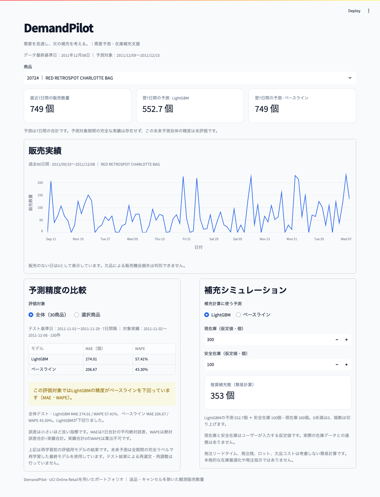
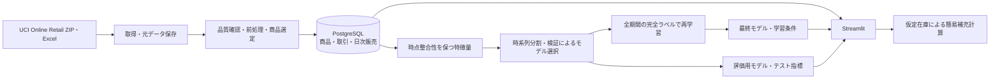

# DemandPilot

> **採用担当者・ポートフォリオ閲覧者の方へ:** 開発目的・技術構成・検証結果を短くまとめた[ポートフォリオ概要](docs/portfolio_summary.md)からご覧いただけます。公開前の確認観点は[チェックリスト](docs/publication_checklist.md)に記載しています。

小売企業の在庫・発注担当者向けの **需要予測・在庫補充支援システム**です。公開取引データの取得から、SQLによる保存、機械学習の時系列評価、Webアプリでの推論・補充シミュレーションまでをローカルで再現できます。

## 解決したい業務課題

商品ごとの直近の販売状況と翌週の販売見込みを同じ画面で確認し、現在庫・安全在庫の仮定を変えながら補充数を検討することを想定しています。予測精度をベースラインと比較して表示し、機械学習の予測が業務判断に使えるかを判断する材料を提供します。

実際の在庫データはありません。補充数は簡易計算で、本格的な在庫最適化や自動発注ではありません。

## 画面



[スマートフォン幅の表示](docs/images/dashboard-mobile.png)

- 30商品を商品コード・商品名で選択。
- 過去90日の日次販売数量と直近7日合計を表示。
- 保存済みLightGBM・直近7日合計ベースラインで、翌7日間の合計数量を表示。日別予測は作りません。
- 全体／商品別のテストMAE・WAPEを切り替え、モデルが下回った場合も表示。
- 仮定の現在庫・安全在庫と使用モデルを変更して、補充数を再計算。

データ最終基準日は **2011年12月8日**、未来予測は **12月9〜15日の合計**です。現在の日付に対する予測ではありません。Web画面から学習や発注は行いません。

## システム構成



Pythonの処理とUIを分離し、PostgreSQLとアプリをDocker Composeで動かします。DBポートはホストへ公開せず、アプリはlocalhostへ公開します。

## 技術スタック

| 用途 | 技術 |
| --- | --- |
| 実行環境 | Python 3.12.9、Docker、Docker Compose |
| データ処理 | pandas 2.2.3、NumPy、openpyxl |
| DB・SQL | PostgreSQL 16.8、psycopg 3.2.5、PostgreSQL COPY |
| モデル | LightGBM 4.6.0、scikit-learn 1.6.1 |
| Webアプリ | Streamlit 1.42.2 |
| 検証 | pytest、Streamlit AppTest、保存モデル照合スクリプト |

依存は`pyproject.toml`と`requirements.lock`に固定しています。実機確認はMac Apple Silicon / Linux aarch64です。Mac側のPythonは不要です。

## 初回実行

Docker Desktopを起動し、このリポジトリをcloneまたはZIPで取得してください。以下はプロジェクト直下で順番に実行します。初回はDockerイメージ・公開データのダウンロードにインターネット接続が必要です。

```sh
cd demandpilot

# 既存の.envを上書きせず、ローカル開発用の設定を用意
if [ ! -f .env ]; then cp .env.example .env; fi

docker compose build
docker compose up -d db
docker compose run --rm pipeline init-db

# 元データ取得・品質確認・日次集計・DB保存
docker compose run --rm pipeline prepare-data

# 検証だけでモデル選択 → テスト評価 → 最終学習 → 未来予測保存
docker compose run --rm pipeline train

# 学習せず、保存済みモデルから予測を再生成
docker compose run --rm pipeline predict

# 実データとモデルを準備した後に全テストを実行
docker compose run --rm --entrypoint pytest pipeline -q

docker compose up -d app
```

**アクセス: http://localhost:8501**

商品20724を選ぶと、直近7日749個、LightGBM予測552.7個、ベースライン749個が表示されます。現在庫300個・安全在庫100個・LightGBMを選択すると補充数は353個です。表示は丸めていますが、補充計算には未丸めの予測値を使います。

`.env.example`のパスワードはローカル開発用サンプルです。実際の認証情報をGitへ保存しないでください。ポート8501が使用中の場合は`.env`の`STREAMLIT_PORT`を変更し、そのポートでアクセスします。モデル・データを準備する前にアプリを起動すると、未準備の案内が表示されます。

### 再起動・状態確認

```sh
docker compose up -d app
docker compose ps
docker compose logs --tail=100 app
docker compose run --rm pipeline check-db
```

停止は`docker compose down`で行えます。名前付きDBボリュームとホストの`data`・`artifacts`は保持されます。ボリューム削除やデータディレクトリ削除は通常の実行手順に含めません。

コードを変えた場合は`docker compose build`後に`docker compose up -d app`。成果物を更新した場合は最大60秒のキャッシュ待ち、または`docker compose restart app`で反映します。

**既存データがある場合:** `prepare-data`はパイプライン専用の3テーブルをトランザクション内で置き換えます。`train`は同名の学習成果物を更新します。既存スナップショットを保持して検証したい場合は、[独立環境での手順](docs/reproducibility.md)を使ってください。

## データ処理

出典は[UCI Online Retail](https://archive.ics.uci.edu/dataset/352/online%2Bretail)。元データ541,909件から、キャンセル・負の数量・非正の単価・商品以外のコード形式・観測期間外の行を除外し、有効取引526,107件を保存します。理由別件数は重複なしで記録し、各条件の該当件数も別に記録します。

学習期間2010-12-01〜2011-08-31だけを使い、販売日数90日以上・履歴180日以上の商品から30商品を選定。将来の販売・商品名を選定に使いません。2010-12-01〜2011-12-08の373日間を0補完し、30商品×373日の11,190行を保存します。

商品説明・顧客IDの欠損は集計に不要なため保持し、顧客IDはDBへ保存しません。完全一致行と大口取引は意味を確認できないため一律削除せず、統計値を記録します。

詳細: [品質確認・除外ルール・実測登録件数](docs/data_preparation.md)

## モデルと実測評価

基準日tの終了時点の直近7・14・28日販売合計、平均、標本標準偏差、月・曜日・日、カテゴリ商品IDから、翌7日合計を予測します。複数商品で一つのLightGBM L1回帰モデルを学習し、検証MAEと早期終了で3候補から選択します。

| 区分 | 使用した予測基準日 | 商品×基準日 |
| --- | --- | ---: |
| 学習 | 2010-12-28〜2011-08-24、毎日 | 7,200 |
| 検証 | 2011-09-01〜2011-10-20、7日間隔 | 240 |
| テスト | 2011-11-01〜2011-11-29、7日間隔 | 150 |

区間境界をまたぐ7日ラベルは除外し、検証・テストの予測対象期間は商品内で重複しません。学習ラベルは重複します。テストはチューニングに使用しません。

| テスト指標 | LightGBM | 直近7日合計ベースライン |
| --- | ---: | ---: |
| MAE（7日間の個数） | 274.01 | 206.67 |
| WAPE | 57.41% | 43.30% |

**LightGBMはテストでベースラインを下回りました。** 商品別では11商品で改善、19商品で悪化。検証では改善した一方、テストで販売水準が変わる商品への追随不足が示唆されます。過学習も否定できません。この結果を見た追加チューニングは行っていません。

最終モデルは固定した設定・139回で、実績7日分が揃う10,170行を再学習します。以前の検証・テスト期間を含むため、そのモデルの訓練結果をテスト精度とは呼びません。12月9〜15日の完全な実績はなく、未来予測自体の精度は未評価です。

詳細: [候補・期間・全30商品のMAE/WAPE・考察](docs/evaluation.md)

## 補充計算と制約

```text
推奨補充数 = max(0, ceil(予測販売数量 + 安全在庫 − 現在庫))
```

現在庫と安全在庫は仮定値です。欠品による潜在需要、発注リードタイム、発注残、ロット、欠品・保管コストは考慮しません。販売なしの日を0とみなしますが、欠品・休業・未収録は区別できません。

詳細: [データ・モデル・補充計算の制約と残課題](docs/limitations.md)

## テスト・再現性確認

先にデータ準備と学習を行ってください。実データ未準備ではUI統合テストがskipします。

```sh
docker compose run --rm --entrypoint pytest pipeline -q
docker compose run --rm --entrypoint python pipeline scripts/verify_model.py
```

全53テストは、前処理、0補完、商品選定の時点整合性、特徴量とラベル、時系列分割、MAE/WAPE、保存モデル推論、DB保存の冪等性・ロールバック、全30商品の画面切り替え、補充入力を検証します。Streamlit内部のAltair非推奨API警告1件が出ますが、表示とテストは成功しています。

実データ再処理の前後比較、既存DBを保持する初期状態からの検証、ブラウザ確認は[再現手順・最終検証](docs/reproducibility.md)を参照してください。

## フォルダ構成

```text
app/                       Streamlit画面
src/demandpilot/
  data/                    取得・前処理・選定・日次集計・DB保存
  features.py              時点整合性を保つ特徴量と目的変数
  modeling/                学習・時系列評価・独立した推論
  dashboard.py             読み取り専用の画面データ取得
  replenishment.py         簡易補充計算
config/settings.yaml       期間・商品数・モデル設定
sql/schema.sql             商品・取引・日次販売のDB定義
tests/                     単体・DB・UI統合テスト
scripts/                   データ・モデル・ブラウザ検証
docs/                      実測結果・考察・再現手順・画面画像
data/raw/                  元ZIP・Excel（Git対象外）
artifacts/                 品質レポート・モデル・評価・予測（Git対象外）
```

`artifacts/ml`には評価用／最終モデル、評価JSON、商品別指標CSV、各区間の予測CSV、未来予測CSV、学習条件JSON、特徴量重要度CSVを保存します。初回実行で生成するため、GitHubから取得した直後には存在しません。

## ポートフォリオで示す実装

データ品質を監査できるETL、SQL・DB保存、漏洩を防ぐ時系列評価、モデルの保存と独立した推論、業務判断を支援するUI、Dockerでの再現と自動テストを一つのシステムにまとめました。精度の改善を保証するプロジェクトではなく、ベースラインとの比較を含めて結果と制約を説明する構成です。

ローカルMVPが対象です。GCPへのデプロイ、実在庫連携、運用監視は未実装です。

## データ出典

Chen, D. (2015). Online Retail [Dataset]. UCI Machine Learning Repository. DOI: [10.24432/C5BW33](https://doi.org/10.24432/C5BW33)。データのライセンスはCC BY 4.0です。元データと生成モデルはリポジトリに含めず、取得・学習コードと実測結果を公開できる構成にしています。
