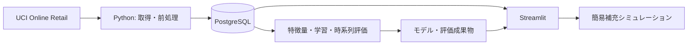

# DemandPilot

需要予測・在庫補充支援システムの転職ポートフォリオ。小売企業の在庫・発注担当者を想定しています。

現在は段階1（実行基盤）です。データ処理・モデル学習・予測画面は未実装で、評価結果もまだありません。

実機確認済み: Python 3.12.9 / Linux aarch64、PostgreSQL 16.8のスキーマ初期化・接続、LightGBM等のインポート、StreamlitのHTTPヘルスチェックおよびAppTestによるDB接続表示。これは実行基盤の確認であり、モデル評価ではありません。

## ローカル実行

Docker Desktopを起動してください。Mac側のPythonは使用せず、Python 3.12をコンテナ内で実行します。Apple Siliconではネイティブarm64イメージを使用します。

```sh
cp .env.example .env
docker compose build
docker compose up -d db
docker compose run --rm pipeline init-db
docker compose run --rm pipeline check-db
docker compose up -d app
```

http://localhost:8501 を開くと、実行基盤の確認画面が表示されます。

```sh
docker compose ps
docker compose logs app
docker compose down
```

`down`ではDBの名前付きボリュームを保持します。`.env`はローカル開発用でGitに含めません。公開環境では認証情報を別途管理してください。PostgreSQLはホストにポートを公開していません。

コード変更後は`docker compose build`でイメージを更新し、`docker compose up -d app`で反映します。

直接依存は`pyproject.toml`、間接依存を含む解決済みバージョンは`requirements.lock`に固定しています。ロックはPython 3.12 / Linux arm64で生成しています。

## 構成



この図は完成予定の構成です。`src/demandpilot`に処理を置き、`app`には画面を置きます。`sql`はDB定義、`config`は処理設定、`data/raw`と`artifacts`はGit対象外のデータ・成果物です。

## ML設計

- 日付`t`の終了時点で`t+1〜t+7`の販売数量合計を予測。
- 直近7・14・28日の実績、移動平均・変動、月・曜日・商品IDを使用。
- 対象約30商品は学習期間の履歴から選定。
- 学習・検証・テストを時系列順に分割し、ラベル期間が次の区間へ入る行を除外。
- 同じテスト行でLightGBMと直近7日合計のベースラインをMAE・WAPEで比較。
- モデルがベースラインを下回る場合もそのまま表示。実績合計が0のWAPEは算出不可。
- 補充数は`max(0, ceil(予測数量 + 安全在庫 − 現在庫))`。

## データと制約

[UCI Online Retail](https://archive.ics.uci.edu/dataset/352/online%2Bretail)を使用予定。541,909件、2010年12月1日〜2011年12月9日の取引。キャンセル・返品・不正な数量や価格・商品以外のコードを確認し、除外理由と件数を記録します。大口取引を一律に異常値としません。

出典: Chen, D. (2015). Online Retail. UCI Machine Learning Repository. DOI: 10.24432/C5BW33. ライセンス: CC BY 4.0。

現在庫・欠品・発注残・リードタイムはデータにありません。予測対象は観測された販売数量であり、潜在需要ではありません。最終日は不完全な集計を避けるため除外する予定です。画面は過去データ上の基準日を表示します。

## 開発段階

1. Docker・PostgreSQL・Streamlitの実行基盤。
2. データ取得・品質確認・前処理・商品選定・日次集計。
3. 漏洩を防ぐ特徴量・時系列評価・モデル保存。
4. 過去90日の実績・予測・精度比較・補充画面。
5. 検証と再現手順・実測評価の文書化。

GCP移行はローカルMVPの後に検討します。DBアクセスと業務ロジックを分離し、BigQuery・Cloud Runへの移行に備えます。
