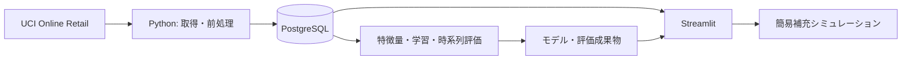

# DemandPilot

需要予測・在庫補充支援システムの転職ポートフォリオ。小売企業の在庫・発注担当者を想定しています。

現在は段階2（データ取得・前処理・日次集計）です。モデル学習・予測画面は未実装で、予測精度の評価結果もまだありません。

実機確認済み: Python 3.12.9 / Linux aarch64、PostgreSQL 16.8のスキーマ初期化・接続、LightGBM等のインポート、StreamlitのHTTPヘルスチェックおよびAppTestによるDB接続表示。これは実行基盤の確認であり、モデル評価ではありません。

## ローカル実行

Docker Desktopを起動してください。Mac側のPythonは使用せず、Python 3.12をコンテナ内で実行します。Apple Siliconではネイティブarm64イメージを使用します。

```sh
cp .env.example .env
docker compose build
docker compose up -d db
docker compose run --rm pipeline init-db
docker compose run --rm pipeline check-db
docker compose up -d app
```

http://localhost:8501 を開くと、実行基盤の確認画面が表示されます。

```sh
docker compose ps
docker compose logs app
docker compose down
```

`down`ではDBの名前付きボリュームを保持します。`.env`はローカル開発用でGitに含めません。公開環境では認証情報を別途管理してください。PostgreSQLはホストにポートを公開していません。

コード変更後は`docker compose build`でイメージを更新し、`docker compose up -d app`で反映します。

直接依存は`pyproject.toml`、間接依存を含む解決済みバージョンは`requirements.lock`に固定しています。ロックはPython 3.12 / Linux arm64で生成しています。

## 構成



この図は完成予定の構成です。`src/demandpilot`に処理を置き、`app`には画面を置きます。`sql`はDB定義、`config`は処理設定、`data/raw`と`artifacts`はGit対象外のデータ・成果物です。

## データ準備（段階2）

```sh
docker compose build
docker compose run --rm pipeline prepare-data
docker compose run --rm --entrypoint pytest pipeline -q
docker compose run --rm --entrypoint python pipeline scripts/verify_snapshot.py before
docker compose run --rm pipeline prepare-data
docker compose run --rm --entrypoint python pipeline scripts/verify_snapshot.py after
```

元のZIPとExcelを`data/raw`に保存し、取得済みZIPは再利用します。Excelは毎回ZIPから復元します。元ExcelのSHA-256、設定、欠損数、除外理由別件数、選定商品、DB登録件数を`artifacts/data_quality.json`に保存します。元データと生成レポートはGit対象外です。

処理は`src/demandpilot/data`の`download`、`clean`、`aggregate`、`storage`、`pipeline`に分離しています。テストは`tests`にあり、DBテストは独立した一時スキーマを使います。

### 前処理ルール

以下の順序で最初に該当した理由を採用します。JSONの`excluded_counts_exclusive`は重複せず合計が総除外数と一致します。`condition_counts_overlapping`は各条件に該当する件数で、同じ行が複数条件に該当する場合があります。

1. 伝票番号欠損、取引日時不正、商品コード欠損。
2. 数量が非数値・非有限・小数・DB整数範囲外、単価が非数値・非有限・DB価格範囲外。
3. C始まりのキャンセル伝票（大小文字を区別しない）。
4. 負の数量（返品・調整）、数量0、単価0以下。
5. 商品コードが数字5桁＋英字0〜2桁に一致しない行（送料・手数料等）。コードは空白除去・大文字化。
6. 観測期間外の行。固定観測期間は2010-12-01〜2011-12-08。終了日途中の影響を避けるため2011-12-09を除外。

商品説明・顧客ID・国の欠損は販売数量集計に不要なため保持します。商品名は学習期間内の最頻説明を使い、欠損時は商品コードを表示名にします。完全一致する行も元取引の意味を確認できないため削除せず、件数のみ記録します。元Excelの行番号を取引主キーにします。

大口取引は削除・クリップしません。数量・単価の分位点と最大値を記録し、卸売を含む販売実績として保持します。商品コードの形式判定には、特殊な商品コードを除外し得る制約があります。

### 商品選定・集計・DB保存

学習期間は2010-12-01〜2011-08-31に固定。学習期間内の販売日数90日以上かつ最初から最後の販売まで180日以上の商品を、販売日数・販売数量の降順、商品コードの昇順で30商品選定します。条件を満たす商品数が不足した場合は処理を停止します。将来の売上・商品名は選定に使いません。後の時系列評価でもこの学習期間の境界を使用してください。

- `products`: 選定30商品の商品コード・学習期間由来の商品名。
- `transactions`: 全商品の前処理後の有効取引。顧客IDはDBに保存しません。
- `daily_sales`: 選定商品の全観測期間について商品×日付の格子を作り、販売のない日は0。DBの取引は地域を限定せず全ての国を含みます。

この3テーブルはパイプライン専用のスナップショットです。再実行時は同一トランザクション内で置き換え、選定ルール変更時も古い商品や行を残しません。同時書き込みをロックし、エラー時は全体をロールバックします。CSV経由ではなくPostgreSQL COPYで登録し、件数と日次数量合計を検証します。

実測結果は[段階2の検証記録](docs/data_preparation.md)に記載しています。元データ541,909件、有効取引526,107件、30商品・11,190日次行。実データの再実行で3テーブルの全行内容が一致し、pytestは23件すべて成功しました。

## ML設計

- 日付`t`の終了時点で`t+1〜t+7`の販売数量合計を予測。
- 直近7・14・28日の実績、移動平均・変動、月・曜日・商品IDを使用。
- 対象約30商品は学習期間の履歴から選定。
- 学習・検証・テストを時系列順に分割し、ラベル期間が次の区間へ入る行を除外。
- 同じテスト行でLightGBMと直近7日合計のベースラインをMAE・WAPEで比較。
- モデルがベースラインを下回る場合もそのまま表示。実績合計が0のWAPEは算出不可。
- 補充数は`max(0, ceil(予測数量 + 安全在庫 − 現在庫))`。

## データと制約

[UCI Online Retail](https://archive.ics.uci.edu/dataset/352/online%2Bretail)を使用。541,909件、2010年12月1日〜2011年12月9日の取引。キャンセル・返品・不正な数量や価格・商品以外のコードを確認し、除外理由と件数を記録します。大口取引を一律に異常値としません。

出典: Chen, D. (2015). Online Retail. UCI Machine Learning Repository. DOI: 10.24432/C5BW33. ライセンス: CC BY 4.0。

現在庫・欠品・発注残・リードタイムはデータにありません。予測対象は観測された販売数量であり、潜在需要ではありません。最終日は不完全な集計を避けるため除外しています。今後の予測画面は過去データ上の基準日を表示します。

## 開発段階

1. Docker・PostgreSQL・Streamlitの実行基盤。
2. データ取得・品質確認・前処理・商品選定・日次集計。
3. 漏洩を防ぐ特徴量・時系列評価・モデル保存。
4. 過去90日の実績・予測・精度比較・補充画面。
5. 検証と再現手順・実測評価の文書化。

GCP移行はローカルMVPの後に検討します。DBアクセスと業務ロジックを分離し、BigQuery・Cloud Runへの移行に備えます。
